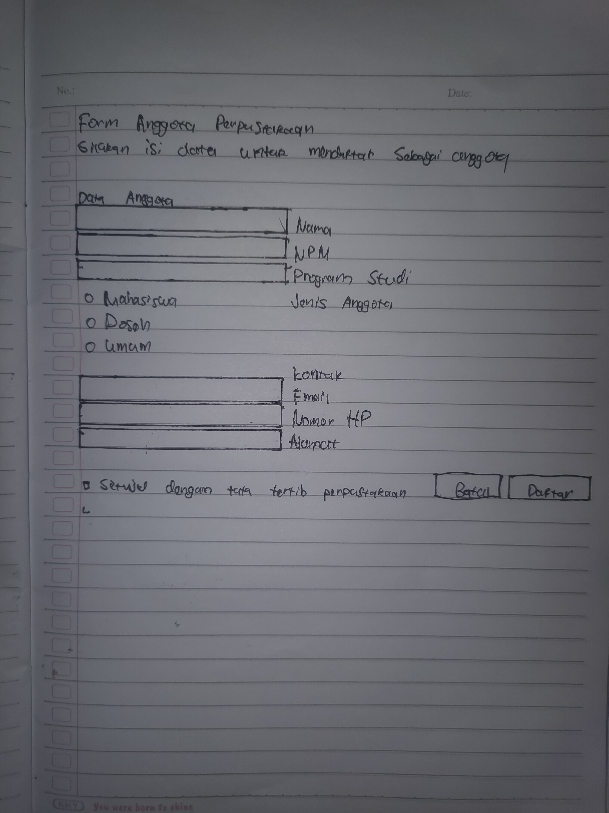

## Studio Desain: Form Anggota Perpustakaan

### Tahap 1: Sketsa

*Gambar 1. Sketsa FormAnggotaPerpustakaan beserta nama layout di setiap bagian*

### Tahap 3: Tabel Komponen FormAnggotaPerpustakaan

| Bagian | Isian | Komponen di Palette |
|--------|-------|---------------------|
| Data Anggota | NPM | Text Field (`npmField`) |
| Data Anggota | Nama lengkap | Text Field (`namaField`) |
| Data Anggota | Program studi | Combo Box (`prodiComboBox`) |
| Data Anggota | Jenis anggota | Radio Button dan Button Group (`mahasiswaRadioButton`, `dosenRadioButton`, `umumRadioButton`, `jenisAnggotaGroup`) |
| Kontak | Email | Text Field dengan placeholder di konstruktor (`emailField`) |
| Kontak | Nomor HP | Text Field dengan placeholder di konstruktor (`hpField`) |
| Kontak | Alamat | Text Area di dalam Scroll Pane (`alamatTextArea`, `jScrollPane1`) |
| Persetujuan | Setuju dengan tata tertib perpustakaan | Check Box (`setujuCheckBox`) |
| Tombol | Batal dan Daftar | Button (`batalButton`, `daftarButton`), Daftar sebagai tombol default |

### Saya menggunakan AI untuk merapikan beberapa penulisan dan bertanya yang kurang saya mengerti

### Tahap 4: Saling Menilai

**Penilai:** Raihan
**Tanggal:** 16 Oktober 2026

| No | Pemeriksaan | Ya atau Belum |
|----|-------------|---------------|
| 1 | Label singkat, jelas, dan sejajar | Belum |
| 2 | Isian dikelompokkan dengan judul bagian | Belum |
| 3 | Placeholder dipakai untuk isian yang punya format | Ya |
| 4 | Komponen sesuai jenis data | Ya |
| 5 | Tombol utama menonjol dan berada di kanan bawah | Ya |
| 6 | Jarak antar komponen konsisten | Belum |
| 7 | Form tetap rapi saat jendela dilebarkan dan ditinggikan | Belum |
| 8 | Tampilan dibuat dengan JFrame Form dan layout manager, bukan Null Layout atau Absolute Layout | Ya |

**Saran perbaikan:**

1. **Posisi label dan isian terbalik.** Label ada di kolom 1 dan isian di kolom 0, jadi label muncul di sebelah kanan isian. Sebaiknya label di kolom 0 dan isian di kolom 1, supaya label terbaca lebih dulu.
2. **Isian belum melebar saat jendela dilebarkan.** Weight X pada isian belum diisi 1.0, sehingga kolom isian tidak ikut melebar. Isi Weight X 1.0 dan Fill Horizontal hanya pada kolom isian, dan biarkan Weight X label 0.0.
3. **Judul bagian "Data Anggota" belum punya posisi yang jelas.** Grid X dan Grid Y-nya belum diisi, sehingga posisinya tidak terkontrol. Letakkan di baris paling atas dengan Grid Width 2. Judul "Kontak" sudah di tengah form, tetapi kedua judul belum diberi gaya `h4` di konstruktor agar tampak sebagai judul bagian.
4. **Jarak antar komponen belum konsisten.** Isian memakai Insets 2 piksel, sedangkan label dan radio button tidak punya Insets. Samakan, misalnya label `6, 0, 6, 12` dan isian `4, 0, 4, 0`, seperti tabel di Praktikum 3.
5. **Label Alamat sebaiknya memakai Anchor Northwest.** Saat ini Anchor-nya West, jadi label berada di tengah tinggi Text Area. Dengan Northwest, label sejajar dengan baris pertama isian.
6. **Beri placeholder juga pada NPM**, misalnya `2410010001`, karena NPM punya format.
7. **Ganti nama bawaan `jScrollPane1`** menjadi nama yang bermakna, misalnya `alamatScrollPane`.

Hal yang sudah baik: komponen sesuai jenis data (Combo Box, Radio Button dengan Button Group, Text Area, Check Box), Daftar menjadi tombol default di kanan bawah, ada ukuran minimum jendela, dan seluruh tampilan memakai layout manager.
