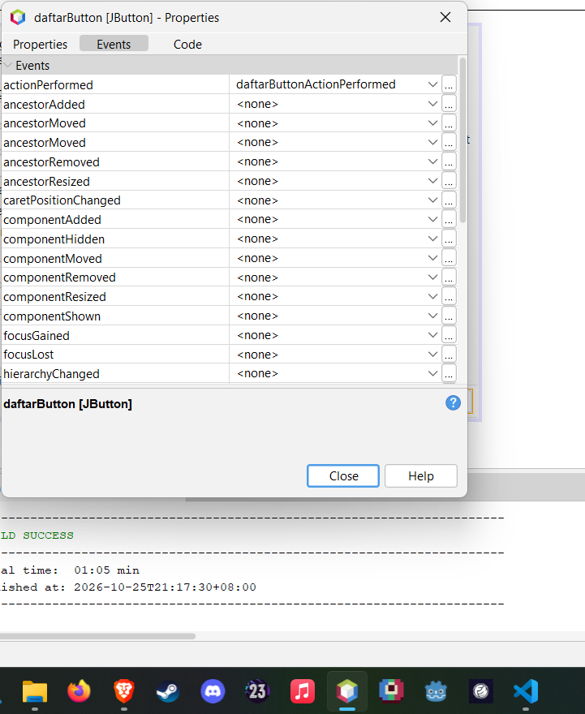
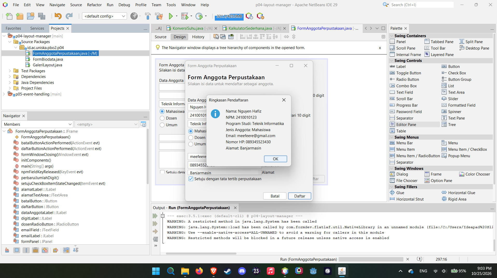
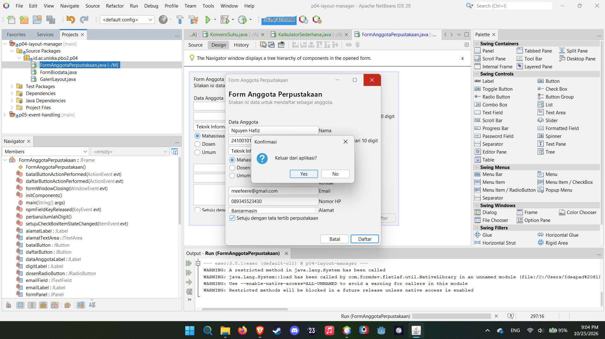

# PBO 2 - Pertemuan 5: Event Handling







## Praktikum 2: Tabel Pengamatan (PengamatEvent)

| No | Tindakan | Event yang tercatat |
|----|----------|---------------------|
| 1 | Arahkan kursor ke tombol, lalu jauhkan | MouseEvent "kursor masuk ke tombol", lalu MouseEvent "kursor keluar dari tombol" |
| 2 | Klik tombol Klik saya | MouseEvent "kursor masuk ke tombol", ActionEvent "tombol diklik", lalu MouseEvent "kursor keluar dari tombol" saat kursor digeser pergi |
| 3 | Centang lalu hapus centang Aktifkan fitur | ItemEvent "kotak dicentang", lalu ItemEvent "centang dihapus" |
| 4 | Ganti pilihan dari Pagi menjadi Malam | ItemEvent "memilih Malam" (hanya satu baris) |
| 5 | Klik isian, lalu ketik kata "abc" | FocusEvent "isian mendapat fokus", lalu KeyEvent "mengetik huruf a", "b", dan "c" (3 baris) |
| 6 | Klik tombol setelah mengetik di isian | MouseEvent "kursor masuk ke tombol", FocusEvent "isian kehilangan fokus", lalu ActionEvent "tombol diklik" |

Catatan: di nomor 4 hanya muncul satu baris karena event DESELECTED untuk pilihan lama tidak dicatat (sudah dicek dengan `ItemEvent.SELECTED`).

---

## Praktikum 3: Konversi Suhu

### Eksperimen 1: hapus pemeriksaan `ItemEvent.SELECTED`

**Berapa kali pesan tercetak setiap pilihan diganti?**

Tercetak **2 kali**. `itemStateChanged` dipanggil dua kali setiap pilihan combo box diganti, yang pertama untuk item lama (`DESELECTED`) dan yang kedua untuk item baru (`SELECTED`). Dengan pemeriksaan `evt.getStateChange() == ItemEvent.SELECTED`, aksinya hanya jalan sekali untuk pilihan yang baru.

### Eksperimen 2: ganti `keyReleased` dengan `keyPressed`

**Mengapa hasil yang tampil terlambat satu karakter?**

Karena `keyPressed` dipicu saat tombol baru ditekan, sebelum karakternya masuk ke text field. Jadi waktu `konversi()` memanggil `celsiusField.getText()`, teks yang terbaca masih teks sebelum ketikan terakhir. Contohnya mengetik `36` lalu `5`: saat tombol `5` ditekan, `getText()` masih `36`, jadi hasil yang tampil masih hasil untuk 36. Kalau `keyReleased`, event-nya dipicu saat tombol dilepas, ketika karakter sudah masuk, jadi teksnya sudah yang terbaru.

### Eksperimen 3: hapus blok `try` dan `catch` di `konversi()`

**Apa yang muncul di jendela Output saat mengetik huruf di isian?**

Yang muncul error `NumberFormatException`, kira-kira seperti ini:

```
Exception in thread "AWT-EventQueue-0" java.lang.NumberFormatException: For input string: "abc"
    at java.base/jdk.internal.math.FloatingDecimal.readJavaFormatString(...)
    at java.base/java.lang.Double.parseDouble(...)
    at id.ac.uniska.pbo2.p05.KonversiSuhu.konversi(...)
```

Penyebabnya `Double.parseDouble("abc")` tidak bisa mengubah huruf jadi angka, lalu melempar exception. Karena tidak ada `catch`, exception-nya tidak ditangani: `hasilLabel` tidak berubah dan pengguna tidak dapat pesan apa pun. Kalau ada `try-catch`, yang tampil pesan "Masukkan angka yang valid".

---

## Praktikum 4: Kalkulator Sederhana

### Eksperimen 1: event `actionPerformed` untuk `kaliButton` tanpa menghapus lambda

**Berapa kali pesan tercetak? Mengapa satu tombol sebaiknya hanya memakai satu cara?**

Pesan `kali` tercetak **2 kali** setiap tombol `x` diklik. Event dari GUI Builder didaftarkan di `initComponents()` lewat `addActionListener`, dan lambda di konstruktor juga memanggil `addActionListener`, jadi tombolnya punya dua listener dan dua-duanya jalan.

Satu tombol sebaiknya satu cara saja karena:
- aksinya jadi berjalan dua kali. Di kalkulator ini hasilnya sama, tapi kalau aksinya menampilkan dialog atau mengubah data, hasilnya jadi ganda atau salah
- kodenya jadi membingungkan karena aksi tombol ada di dua tempat
- kalau ada perubahan, gampang lupa mengubah salah satunya

### Eksperimen 2: tambah tombol `%` (sisa bagi)

**Apa saja yang diubah di tab Design dan di tab Source?**

Tab Design:
1. Tambah Button baru di `operatorPanel`, beri nama `modulusButton`, teksnya `%`.
2. Ubah Columns Grid Layout `operatorPanel` dari 4 menjadi 5 supaya tampilannya rapi.
3. Buat event lewat klik kanan `modulusButton`, Events, Action, `actionPerformed`.

Tab Source:
1. Isi event handler yang dibuat NetBeans:

   ```java
   private void modulusButtonActionPerformed(java.awt.event.ActionEvent evt) {
       hitung('%');
   }
   ```

2. Tambah `case '%' -> a % b;` di `switch` pada method `hitung`, sebelum `default`. Kalau tidak, `%` jatuh ke `default` dan malah dihitung sebagai pembagian.
3. Pemeriksaan pembagi nol dibuat mencakup `%` juga:

   ```java
   if ((operator == '/' || operator == '%') && b == 0) {
       hasilLabel.setText("Tidak dapat membagi dengan nol");
       return;
   }
   ```

Kode di `initComponents()` dan file `.form` berubah sendiri oleh NetBeans, jadi tidak diketik manual.

### Eksperimen 3: tombol Hapus

**Mengapa kursor langsung berada di isian pertama?**

Karena baris terakhir method `hapus` memanggil `angka1Field.requestFocusInWindow();`. Waktu tombol Hapus diklik, fokus keyboard pindah ke tombol itu, lalu baris tersebut mengembalikan fokus ke `angka1Field`. Jadi pengguna bisa langsung mengetik angka baru tanpa klik isian dulu.

---

## Latihan Mandiri: Peta Event FormAnggotaPerpustakaan

| Komponen | Menu Events | Aksi |
|----------|-------------|------|
| `setujuCheckBox` | Item: itemStateChanged | Tombol Daftar hanya aktif jika dicentang |
| `batalButton` | Action: actionPerformed | Kosongkan semua isian dan kembalikan fokus ke NPM |
| `daftarButton` | Action: actionPerformed | Tampilkan ringkasan data dengan JOptionPane |
| `npmField` | Key: keyReleased | Label kecil menampilkan jumlah digit, misalnya "8 dari 10 digit" |
| Form (JFrame di Navigator) | Window: windowClosing | Minta konfirmasi sebelum aplikasi ditutup |

Pengaturan lain lewat jendela Properties: `defaultCloseOperation` form diubah ke `DO_NOTHING`, dan `enabled` pada tombol Daftar dihilangkan centangnya.

---

## Deklarasi Penggunaan AI

Saya memakai Claude sebagai alat bantu untuk menjelaskan bagian modul yang kurang dimengerti, serta merapikan penulisan readme.md.