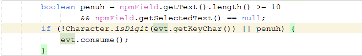
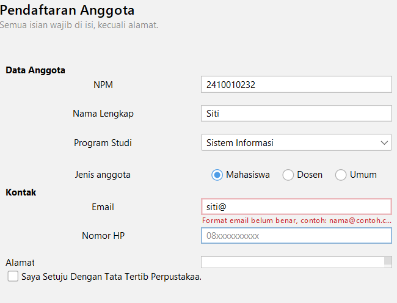
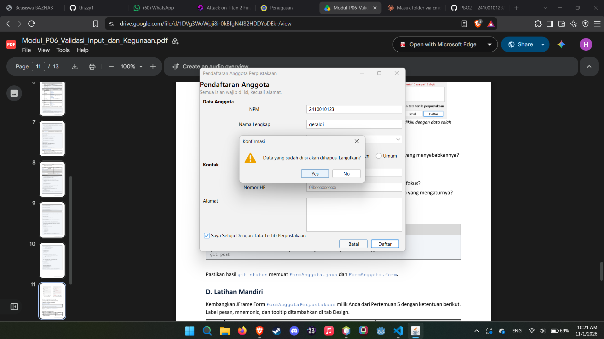
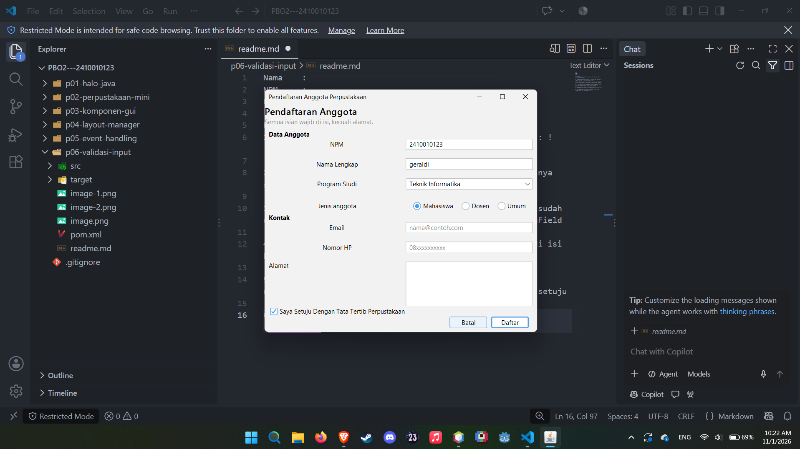

### Nama    : M Hafiz Ilmi
#
### NPM     : 2410010123
#
### Kelas   : 5A

# Eksperimen :
1. tidak bisa memasukan huruf ke field NPM, di baris ini : 

2. Pesan kesalahan muncul setelah di klik tab, dan munculnya seperti foto ini : 

3. Tidak muncul pesan kesalahan karena didalam code yang sudah dibuat, tidak ada bagian code pesan peringatan untuk namaField

4. 5 Isian kecuali jenis anggota dan alamat, yang perlu di isi NPM, Nama lengkap, Program studi, Email, dan Nomor HP

5. Isian namaField, properti yang mengaturnya itu displayMnemonic / Mnemonic kalau dibagian tombol centang setuju

6. Data tetap ada, foto sebelum di klik no :   Foto sesudah di klik no : 

# Lembar Peer Review Heuristik

**Nama peninjau:** Raihan Alfa Rizky
**Nama pemilik form:** M Hafiz Ilmi

| No | Heuristik | Temuan | Skor 0-4 | Saran |
|----|-----------|--------|----------|-------|
| 1 | Visibilitas status sistem | Tombol **Daftar** nonaktif secara otomatis saat kotak persetujuan belum dicentang; status jumlah error dan ringkasan validasi muncul di `statusLabel` bawah. | 1 | Tambahkan tooltip pada tombol Daftar atau panduan visual saat tombol nonaktif agar pengguna tahu harus mencentang persetujuan. |
| 2 | Kesesuaian dengan dunia nyata | Kolom NPM bersifat wajib diisi dengan format 10 digit angka, namun belum dinamis jika ada pendaftar dari kategori Dosen atau Umum yang tidak memiliki NPM. | 3 | Buat validasi NPM menjadi kondisional berdasarkan pilihan jenis anggota (Mahasiswa/Dosen/Umum), atau ubah label menjadi identitas alternatif jika diperlukan. |
| 3 | Kendali dan kebebasan pengguna | Tombol **Batal** dilengkapi dialog konfirmasi (`JOptionPane.showConfirmDialog`) jika terdapat data yang sudah diisi. Form juga dikosongkan otomatis setelah pendaftaran sukses. | 1 | Pertimbangkan menambahkan konfirmasi "Daftarkan data ini?" sebelum data benar-benar disimpan ke sistem. |
| 4 | Konsistensi dan standar | Tata letak menggunakan standar formulir vertikal dengan `GridBagLayout`. Label judul bagian (`dataAnggotaLabel`, `kontakLabel`) sudah diperjelas menggunakan gaya teks FlatLaf (`h4`). | 1 | Pastikan konsistensi penamaan label (misal: "Nama Lengkap" vs "Nama") dipertahankan di seluruh form. |
| 5 | Pencegahan kesalahan | Validasi input (`keyTyped` / `FocusLost`) membatasi panjang digit NPM maksimal 10 angka dan memfilter format nomor HP serta email dengan pesan error yang jelas. | 1 | Perketat validator pada `Validator.nama` agar simbol khusus seperti `@` atau `#` otomatis ditolak saat diinput. |
| 6 | Mengenali, bukan mengingat | Placeholder sudah diterapkan pada `npmField` (*"Contoh: 2410010123"*), `emailField`, dan `hpField` untuk memandu format input pengguna. | 0 | Pertahankan implementasi placeholder karena sudah sangat membantu pengguna mengenali format isian tanpa harus menghafal. |
| 7 | Fleksibilitas dan efisiensi | Tombol pintas (*Mnemonic*) sudah terpasang pada tombol Batal ('B'), Checkbox Persetujuan ('T'), dan field utama lainnya. Tombol **Daftar** diatur sebagai `defaultButton` pada root pane. | 0 | Implementasi jalan pintas keyboard dan tombol Enter (`defaultButton`) sudah efisien untuk pengguna tingkat lanjut. |
| 8 | Desain estetis dan minimalis | Antarmuka menggunakan tema modern FlatLaf dengan jarak margin padding yang rapi (`EmptyBorder(8, 8, 8, 8)`) serta label pesan error tersembunyi dengan baik (`" "`). | 0 | Desain visual sudah bersih, minimalis, serta mendukung mode tampilan terang dan gelap (*Light/Dark mode*). |
| 9 | Membantu memperbaiki kesalahan | Pesan kesalahan spesifik dengan garis merah (`"error"`) muncul di bawah komponen isian yang salah, serta tombol fokus otomatis diarahkan ke input bermasalah pertama. | 0 | Penanganan umpan balik kesalahan sudah sangat interaktif dan informatif bagi pengguna. |
| 10 | Bantuan dan dokumentasi | Keterangan petunjuk pengisian *"Semua isian wajib di isi, kecuali alamat"* sudah dicantumkan secara jelas pada bagian header form (`keteranganLabel`). | 0 | Panduan bantuan pada bagian atas form sudah cukup jelas menerangkan status field wajib dan opsional. |

**Keterangan skor:** 0 bukan masalah, 1 kosmetik, 2 minor, 3 mayor, 4 kritis.

**Deklarasi Penggunaan AI :** AI digunakan untuk membantu menjelaskan beberapa bagian yang tidak dimengerti di modul untuk bagian peletakan code